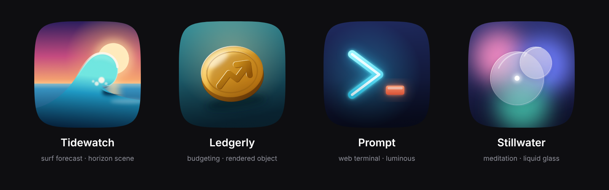

# iphone-icon — a Claude skill that designs real home-screen icons for web apps

[English](#english) · [繁體中文](#繁體中文)



---

## English

Give Claude a web page (or just a description of the app) and get back an iPhone home-screen icon
that was **designed** — metaphor, material, light, palette — rather than a shape dropped on a
gradient. The skill renders every size iOS/Android need, judges the icon on a simulated home screen
among bright neighbours before calling it done, and wires the `<head>` tags and manifest — or, if
your project already has an icon pipeline, works inside it instead of overwriting it.

### What you get
```
icon.svg                      editable 1024 master
icons/apple-touch-icon.png    180×180 — the file iOS actually uses
icons/icon-512.png · icon-192.png · icon.svg
icon-design/                  not deployed: icon-1024.png, preview.png (home screens, 60/40/29/20pt), grid.png
manifest.webmanifest          + a managed block in your HTML <head>
```

### Install (Claude Code)
```bash
# personal skill — available in every project
git clone https://github.com/yoyoCadence/Iphone_Icon_AI-skill.git ~/.claude/skills/iphone-icon
```
```bash
# or project skill — committed with one repo
git clone https://github.com/yoyoCadence/Iphone_Icon_AI-skill.git .claude/skills/iphone-icon
```
Rendering needs Node ≥ 18 with Playwright's Chromium (one-time):
```bash
npm i -g playwright && npx playwright install chromium
```
```bash
pip install pillow
```
Without Playwright the renderer falls back to `rsvg-convert` / ImageMagick (filters degrade) and
the preview sheet is skipped. For claude.ai, zip this folder (SKILL.md at the zip root) and upload
it under *Settings → Capabilities → Skills*.

### Use
Just ask, in any language:
- "Make an icon for this page so people can add it to their iPhone home screen."
- "My PWA is called Swell, surf forecasts, brand colour #0E7490 — I need the apple-touch-icon and manifest icons."
- "幫我這個記帳網頁做一個加到主畫面用的 icon，不要幾何圖形那種。"

Claude writes a concept note, blocks the silhouette out flat, checks it at 29pt among bright
neighbours, adds material, renders, **looks at the preview and the 1024 grid**, revises, then
delivers. One to three material rounds is normal — that is the process working.

### How it works
0. **Existing icon?** If the project has an icon source, build script, icon tests or a service worker, those are the contract: edit its source, run its build and tests, present before/after.
1. **Brief** — name (≤ 11 chars), purpose, tone, brand colours; `extract_brand.py` pulls them from your HTML/CSS.
2. **Concept** — metaphor ladder (object → action → feeling → letter); three tests: readable at 29pt, ownable, no collision with famous icons.
3. **Build — bold first, beautiful second** — flat block-out, then one of seven style recipes (lit glyph, rendered object, liquid glass, layered paper, luminous, monogram, horizon scene) with SVG lighting rigs.
4. **Render → critique** — `render.js` makes the PNGs and a home-screen preview among saturated neighbours; `validate.py` reports transparency, subject coverage, centre of mass, mask intrusion and contrast; Claude reads the images and fixes what it sees.
5. **Deliver** — `inject.py` wires the head block and manifest, keeps the page's own choices, picks URLs that survive your hosting, and refuses to rewire a page that is already wired.

### Scripts (usable on their own)
| | |
|---|---|
| `node scripts/render.js icon.svg --out icons --preview-dir icon-design --label "Name" --grid` | PNG set + preview sheet + grid; `--draft` for block-outs |
| `node scripts/render.js --compare a.svg b.svg --out icon-design` | concepts side by side at hero, 60pt and 29pt |
| `python3 scripts/validate.py icon-design/icon-1024.png` | mechanical checks, advisory |
| `python3 scripts/inject.py index.html --name "Name" --bg "#0e3646"` | head tags + manifest; `--print` when there is no HTML yet |
| `python3 scripts/ribbon.py --spiral … / --path …` | strokes whose width and colour change along their length |
| `python3 scripts/extract_brand.py index.html styles.css` | title, colours, fonts, copy, existing icon wiring |

### Tested
- **Showcase** — eight icons from fresh runs, unretouched, scored honestly (6/10 to 8/10) with the
  skill's remaining bias named. → [docs/showcase.md](docs/showcase.md)
- **Evals** — three briefs, with vs. without the skill, three iterations; the first lost one case
  to the baseline (timid at home-screen size), the fixes are documented, and the latest versions win
  or match on every case;
  triggering 60/60 correct on 20 realistic and near-miss queries. → [docs/evals.md](docs/evals.md)
- **Field test on a real PWA** with its own icon build, e2e icon test and service worker; the
  redesign passed the project's own test, and the test exposed (and led to fixing) the skill's most
  damaging bugs. → [docs/field-test-orbit.md](docs/field-test-orbit.md)

### FAQ
**The icon on my phone didn't change.** iOS caches web-clip icons by URL and never refreshes an
existing shortcut. `inject.py` adds `?v=<hash>`; remove the shortcut and add it again. If the site
has a service worker that serves images cache-first, bump its cache version too.

**Black corners / a black square.** The PNG had transparency. iOS composites over black. The tile
must be full-bleed; `validate.py` flags this.

**Double rounded corners.** Rounding was baked into the PNG. Keep it square — iOS applies the mask.

**Icons 404 after deploying.** Relative URLs break on single-page-app routes (`/spot/123`);
root-absolute URLs break under a sub-path (GitHub Pages `/<repo>/`). See the table in
`references/ios-delivery.md` and pass `--web-path` accordingly.

**Can it match my existing logo?** Yes — put the logo SVG/PNG in the project and say so; the skill
will treat it as the glyph and build the material and tile around it.

---

## 繁體中文

把網頁（或只是一句話描述你的 app）交給 Claude，拿回一個**真正被設計過**的 iPhone 主畫面圖示——
有隱喻、有材質、有光線、有配色，而不是「一個幾何圖形放在漸層上」。這個 skill 會輸出 iOS／Android
需要的所有尺寸，先把圖示放進「鄰居都很搶眼」的模擬主畫面上檢查，再把 `<head>` 標籤與 manifest
接到你的網頁；如果專案本來就有自己的 icon 流程，它會在那套流程裡工作，而不是覆蓋掉。

### 你會拿到
```
icon.svg                      可編輯的 1024 母檔
icons/apple-touch-icon.png    180×180 —— iOS 真正讀取的檔案
icons/icon-512.png · icon-192.png · icon.svg
icon-design/                  不部署：icon-1024.png、preview.png（主畫面預覽，60/40/29/20pt）、grid.png
manifest.webmanifest          + HTML <head> 內一段受管理的標籤區塊
```

### 安裝（Claude Code）
```bash
# 個人 skill——所有專案都能用
git clone https://github.com/yoyoCadence/Iphone_Icon_AI-skill.git ~/.claude/skills/iphone-icon
```
```bash
# 或專案 skill——跟著單一 repo 走
git clone https://github.com/yoyoCadence/Iphone_Icon_AI-skill.git .claude/skills/iphone-icon
```
出圖需要 Node ≥ 18 與 Playwright 的 Chromium（只需一次）：
```bash
npm i -g playwright && npx playwright install chromium
```
```bash
pip install pillow
```
沒有 Playwright 時會退回 `rsvg-convert` / ImageMagick（濾鏡效果會打折，且不產生預覽圖）。
在 claude.ai 使用：把這個資料夾壓成 zip（SKILL.md 在 zip 根目錄），到
*Settings → Capabilities → Skills* 上傳。

### 使用
直接用自然語言說：
- 「幫我這個網頁做一個加到主畫面用的 icon。」
- 「我的 PWA 叫 Swell，衝浪預報，品牌色 #0E7490，需要 apple-touch-icon 和 manifest 的圖。」
- 「幫我這個記帳網頁做 icon，不要幾何圖形那種。」

Claude 會寫概念筆記 → 先用平塗色塊打底、在 29pt 和搶眼鄰居旁邊檢查 → 再加材質 → 出圖 →
**看預覽和 1024 格線圖** → 修改 → 交付。一到三輪材質修改是正常的，這是流程在運作。

### 運作方式
0. **已經有 icon 嗎？** 專案若有 icon 原始檔、建置腳本、icon 測試或 service worker，那就是契約：改它的原始檔、跑它的建置與測試，並給前後對照。
1. **需求**：名稱（≤ 11 字）、用途、調性、品牌色；`extract_brand.py` 會從 HTML/CSS 抓出來。
2. **概念**：隱喻階梯（物件 → 動作 → 感受 → 字母），三個檢驗：29pt 看得懂、換成競品會被發現、不撞知名 icon。
3. **先求醒目，再求精緻**：平塗打底，再套七種風格配方之一（受光字形、實體物件、液態玻璃、層疊紙張、發光線條、單字母、地平線場景），每種附 SVG 打光骨架。
4. **出圖 → 審視**：`render.js` 產生 PNG 與主畫面預覽；`validate.py` 回報透明、主體面積、重心、遮罩侵入、對比；Claude 看圖修圖。
5. **交付**：`inject.py` 寫入 head 區塊與 manifest，保留頁面原有設定，依部署方式選對網址；已經接好的頁面它會拒絕覆蓋。

### 實測
- **作品展示**：八個由全新執行產出、未經修圖的 icon，逐一誠實評分（6～8 分），並寫明 skill 目前的系統性偏差。→ [docs/showcase.md](docs/showcase.md)
- **評測**：三個情境、有／無 skill 對照、三輪迭代；第一輪曾輸 1 場（主畫面尺寸下太不醒目），修正過程有完整紀錄，最新版本在每個情境都勝出或持平；觸發測試 20 個真實與易混淆查詢 60/60 全對。→ [docs/evals.md](docs/evals.md)
- **真實專案實測**：一個有自己 icon 建置、e2e icon 測試與 service worker 的 PWA；新設計通過該專案自己的測試，而這次實測也揪出並修正了 skill 最具破壞性的幾個 bug。→ [docs/field-test-orbit.md](docs/field-test-orbit.md)

### 常見問題
**手機上的圖示沒更新。** iOS 以 URL 快取 web clip 圖示，且既有捷徑永遠不會自己刷新。
`inject.py` 會加上 `?v=<hash>`；請移除捷徑再重新加入。若網站有「圖片優先讀快取」的 service worker，
也要一併更新它的快取版本。

**角落是黑的／整個變黑方塊。** PNG 有透明區域，iOS 會把它疊在黑色上。底圖必須滿版；`validate.py` 會警告。

**圓角變成兩層。** PNG 裡已經烤進圓角。保持方形——遮罩由 iOS 套用。

**部署後圖示 404。** 相對路徑在單頁應用的子路由（`/spot/123`）會失效；以 `/` 開頭的路徑在子目錄部署
（GitHub Pages 的 `/<repo>/`）會失效。依 `references/ios-delivery.md` 的表格選擇並傳入 `--web-path`。

**能用我現有的 logo 嗎？** 可以——把 logo 的 SVG/PNG 放進專案並說明，skill 會把它當作主字形，再圍繞它建立材質與底圖。

---

MIT License · built with the Claude skill-creator workflow; evals live in `evals/`, results in `docs/`.
