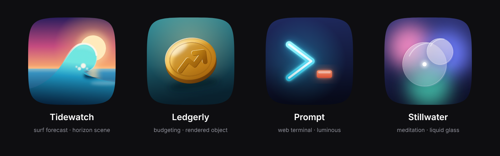

# Worked examples

Five icons produced with this skill's own pipeline, each with the concept note that preceded the
SVG. They exist to calibrate the quality bar and to show one recipe each — copy the *approach*,
never the icon. **If a brief falls in one of these categories (surf/ocean, budgeting/coins,
terminals, meditation), don't reuse the example's twist, palette or execution** — test runs showed
agents drifting toward the nearest example. Do keep the category's core sign (the prompt for a terminal,
a coin or ledger for money) when the icon needs it to read at 29pt; a run that dropped the prompt
entirely to look different produced a unique icon that read as "@" at small size. If the user's real
brand colours match an example's, the brand wins — differ in object and composition instead.



Render any of them yourself:
```bash
node scripts/render.js assets/examples/tidewatch.svg --out /tmp/tw --label Tidewatch --grid
python3 scripts/validate.py /tmp/tw/icon-1024.png
```

## Tidewatch — surf & tide forecasts · style G (horizon scene)
```
Tone: calm · precise · outdoors          Essence: know the ocean before you go
Idea: one wave at the instant of breaking, backlit by a low sun (literal object + its action)
Palette: dusk sky #2A1D5C → #C44A7E → #FFB36B · sea #3E9FD0 → #0A3C66 · body #6FE6E0 → #072A4C · foam #FFF7EC
Light: the sun, top-right, behind the lip (translucent crest, foam rim, reflection streak)
```
What to learn: a scene may fill the tile, but the *focal element* (crest + sun) sits in the centre
62 %; atmospheric haze at the horizon and a dark barrel give depth with two shapes.

## Ledgerly — personal budgeting · style B (rendered object)
```
Tone: trustworthy · tactile · optimistic     Essence: your money, quietly going up
Idea: a gold coin seen slightly from above with a rising arrow embossed (object + attribute)
Palette: teal tile #2F8E9A → #0A2838 (deliberately not finance-green) · gold #FFEDB0 → #F4B737 → #C47A12
Light: top-left; AO under the coin, inner shadow for thickness, form-shading crescent, rim + specular
```
What to learn: thickness (offset darker ellipse), an emboss built from ±4 px offset copies, and a
tilt of −8° are what make it a *thing* instead of a sticker.

## Prompt — web terminal · style E (luminous)
```
Tone: focused · night · ready             Essence: the cursor is waiting for you
Idea: the prompt chevron as a glowing wedge with one warm block cursor (cliché kept, material changed)
Palette: navy #1F2A5E → #090D22 · cyan glow #5EF1FF · accent #FF7A59
Light: emitted by the glyph itself; haze behind so the tile is never flat black
```
What to learn: two glows (tight + wide) under a hot white core; a single warm accent against a
cool glow; the group scaled 1.12× after the first render looked timid.

## Stillwater — meditation timer · style C (liquid glass)
```
Tone: calm · airy · modern iOS            Essence: find the still point
Idea: two overlapping glass "ripple" panes with one white still point (feeling rendered as glass)
Palette: indigo base #2E3272 → #111433 · blobs #FF8FC8 / #6D7CFF / #4FE3C8 · glass white 0.12–0.46
Light: top-left edge highlights on each pane; colour comes from under the glass
```
What to learn: glass only works over colour; the refraction copy (same shape, offset 10 px, 16 %
opacity) and the gradient edge stroke are what sell translucency.

## Tempo — music discovery · style H (brand mark, graphic family)
```
Tone: energetic · young · a little rebellious     Essence: every swing, a new artist
Market: flat marks on black, white or one hot colour (Spotify, SoundCloud, Tidal, YouTube Music);
        red, orange and green taken; discs and notes taken → violet/yellow and a new silhouette are open
Idea: a metronome whose arm is flung out through its own side — a cut-out slot inside the body,
      solid outside (figure-ground switch as the ownership move)
Palette: tile #5C2FF4 → #4A20D8 · mark #FFE53B · no accent, no light source
```
What to learn: a flat mark is finished when its geometry is exact (64-px module, one repeated corner
radius), not when it has shadows; the ownership lives in the silhouette. Made in the market benchmark
(`docs/market-benchmark.md`) — the only graphic-family example here, added because four illustrative
examples were themselves pulling runs toward lit objects.
