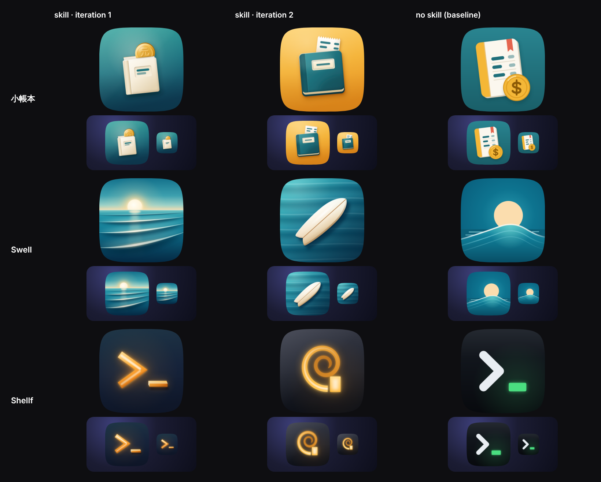

# How this skill was tested

Three briefs, each run by a fresh agent **with** the skill and **without** it (same model, same
tools, Playwright and Pillow available to both), graded on objective assertions and judged visually
at home-screen size. Test cases live in `evals/` in the `claude plugin eval` layout.

| Case | Brief |
|---|---|
| `budget-app-zh-with-html` | 「小帳本」 budgeting page in Traditional Chinese, brand teal + amber, wire it into `index.html` |
| `surf-pwa-no-code` | "Swell" surf-forecast PWA, no code yet, brand `#0E7490`, "not a generic wave emoji" |
| `dark-dev-tool` | "Shellf" web terminal, dark, "hacker-ish but not cheesy", files into `./public/icons` |

## Results

| | Iteration 1 | Iteration 2 |
|---|---|---|
| Assertion pass rate, with skill | 100 % | 100 % (16/16) |
| Assertion pass rate, without skill | 78 % | 89 % (14/16; assertions reworded to be layout-agnostic) |
| Visual verdict vs. baseline | **won 1, mixed 1, lost 1** | **won 2 (小帳本, Swell), mixed 1 (Shellf)** |
| Tokens / time per with-skill run | ~171 k / ~9 min | ~185 k / ~9.5 min |

Assertions saturate quickly — the baseline model is already competent at delivery — so the visual
comparison is the signal that matters. What changed between iterations, and why:

- **Iteration 1 lost 小帳本** with a refined but small, pale ledger (22 % of the tile) to a bold flat
  notebook (37 %). Cause: the preview sheet placed the icon among muted grey placeholders, which
  flatters timid icons, and the validator measured a bounding box instead of the subject's area.
  Fix: bright, saturated neighbours in the preview; subject coverage in `validate.py`; a
  "bold first, beautiful second" block-out step. Iteration 2's first draft was caught immediately;
  the final covers 33 %.
- **Iteration 1's Swell** was a beautiful horizon that read as a photo at 29pt. Fix: style G now
  requires one focal shape ≥ 24 % of the width. Iteration 2 delivered a surfboard on swell lines.
- **Iteration 2's Shellf** was unique (a nautilus spiral ending in a cursor) but read as "@" at
  29pt — caused by an over-strong anti-anchoring rule that pushed the agent away from the terminal's
  core sign. Fix: keep the category's core sign when legibility needs it; avoid only the example's
  twist, palette and execution.

## Bugs found by the test agents (all fixed)

Inverted inner-shadow offset (raised shapes looked dented) · percentage filter regions clipping stroked
shapes · filter regions in local coordinates clipping inside transformed groups · `inject.py`
defaulting to root-absolute URLs and overwriting a page's own `theme-color` · `--print` writing the
snippet into a deployed folder · dark-brand palette formula producing near-black · `metaphors.md`
recommending the worked examples' own twists · previews and the 1024 master landing in `public/`.

## Triggering

20 realistic queries (10 should trigger, including Chinese and indirect phrasings such as "make it
feel like a real app"; 10 near-misses such as og:image cards, iMessage stickers, Swift alternate
icons, splash screens, a print logo) × 3 runs each: **60/60 correct** (recall 100 %, precision 100 %).

Two defects in the measuring tool were found on the way — worth knowing if you run
`skill-creator`'s description optimizer yourself:
1. With parallel workers, each worker installs its own copy of the skill into the same
   `.claude/commands/`; Claude sees N identical skills and picks one, so the measured trigger rate
   collapses to exactly 1/N. Run with `--num-workers 1`.
2. Runs that fail on a usage limit are scored as "did not trigger", so the optimizer "fixes" a
   description that was never broken. Its rewrites (more keywords, "MANDATORY") measured worse.
