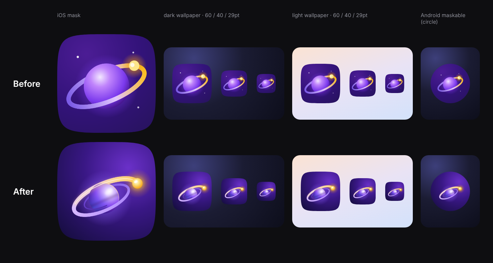

# Field test: Orbit (a real PWA with its own icon pipeline)

[Orbit](https://github.com/yoyoCadence/Orbit) is a vanilla-JS growth-tracking PWA deployed to
GitHub Pages under `/Orbit/`. It already had an icon: `art-pipeline/app-icon/icon.svg`, rendered
by `npm run icons` (`scripts/make-icons.mjs`) and guarded by an e2e test
(`tests/e2e/ui203-app-icon.test.js`) that checks sizes, opaque corners, and that every non-background
pixel stays inside the inscribed circle (so the maskable icon's art stays inside Android's 40% safe
zone). It also has a service worker that serves images cache-first.

This is the case a fresh-page demo never exercises, so it found the skill's most expensive bugs.

## What the skill concluded about the existing icon

| Test (critique.md order) | Verdict |
|---|---|
| 29pt | passes — clean silhouette, 4.2:1 contrast |
| Ownership | **fails** — a purple ringed planet is the default picture for anything named "Orbit" (VPNs, browsers, astronomy apps); nothing says *growth*, the product's core |
| Restraint | three stars are noise below 40pt; the ring reaches 88% of the tile |

So the redesign is an **evolution**, not a replacement: same purple and gold, same orbit, new
meaning. The orbit becomes a spiral that widens and brightens as it climbs ("daily effort
accumulating into a trajectory"), and the gold body becomes the light source that lights the
sphere. Three render rounds:
1. single visible loop — growth did not read; segment seams striped the ribbon; mass sat high;
2. 1.75 turns so an inner thin loop and an outer thick loop are both visible; opaque segments;
3. softened the ribbon's cast shadow (it read as Saturn's bands) and moved the hot core to the
   last quarter so brightness rises toward the gold body.

Honest result: stronger meaning and motion; at 29pt both versions still read "planet with a ring"
(so the brand equity carries over); the sphere is smaller and more occluded. Whether that trade is
right is the owner's call.

## Verified against the project's own contract

| Check | Result |
|---|---|
| Orbit's renderer (`npm run icons`) | produced all four PNGs from the new SVG |
| Orbit's e2e icon test, old icon | 2/2 pass |
| Orbit's e2e icon test, **v1** of the redesign | **fails**: maskable reach 0.419 > 0.4 — the moon glow's faint tail crossed the circle |
| Orbit's e2e icon test, final | 2/2 pass (reach 0.469 full-bleed, 0.375 maskable) |

`validate.py` did not catch the v1 failure — the limit is project-specific (alpha reach of soft
glows), which is why SKILL.md now says the project's own icon tests are the contract.

## Bugs it exposed in the skill (all fixed)

| Problem | What would have happened to Orbit | Fix |
|---|---|---|
| `inject.py` rewired any page | removed Orbit's commented `theme-color` / status-bar choices (BUG-117), swapped `manifest.json` (with `lang`, `orientation`, `description`, separate maskable PNG) for a new file | refuses when a page is already wired (prints the paths to render to); `--force` updates the existing manifest in place and keeps every field it does not own |
| root-absolute default URLs (`/icons/…`) | 404 on GitHub Pages under `/Orbit/` | URLs relative to the page by default |
| no "existing icon" step | the skill would design from zero and ignore the project's build and tests | Step 0 in SKILL.md: find the pipeline, edit its source, run its build and tests, render the old icon for a before/after |
| service-worker caching not mentioned | the new icon would be served stale until the worker's cache version changed | ios-delivery.md: bump the worker's cache version with the icon change |
| variable-width / colour-graded strokes need hand-written geometry | (the spiral had to be generated by a one-off script) | `scripts/ribbon.py` — `--spiral` with front/back occlusion, `--path`, width/colour along the length |

The redesigned SVG and its generator were prepared on a local branch of Orbit; nothing was pushed
to the Orbit repository.
