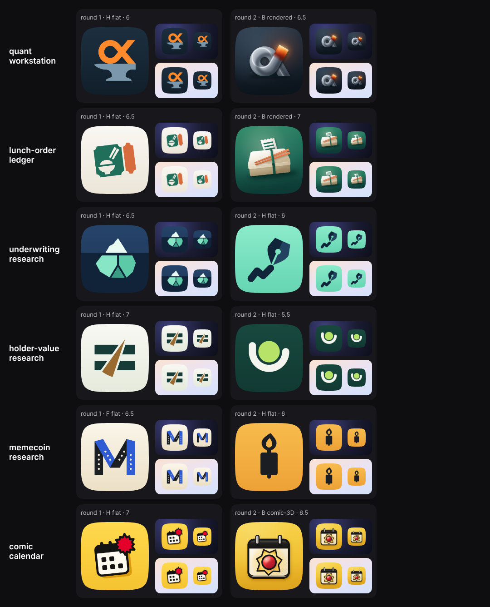

# Field test — ten real projects, and the rule change they forced

The market benchmark (`market-benchmark.md`) used invented briefs. This round ran the skill on the
**ten most-committed real projects** of one developer, using each project's own README, HTML/CSS,
manifest, brand docs and current icon. The projects were a growth tracker, a quant workstation, a
comic-style calendar, a browser racing game, two tokenized-markets research engines, a portfolio
dashboard, a memecoin research tool, an office lunch-order ledger and a dinner picker. Each run had
only the skill, the project's files and a folder of the category's real App Store leaders as
`--neighbours`. Nothing was wired into the projects. Every score is one reviewer's judgement by eye
of a single run, made among the real leaders at 60pt and 29pt.

## Round 1 — two gates, then tone

Average **6.65**, below the benchmark's 7.4. Real projects are harder than invented briefs: half are
developer tools whose purpose is abstract. Every icon passed the mechanical checks. Two were strong:
a die with a bite out of it for the dinner picker (7.5), and the growth tracker's orbit (7.5).

The style choice had drifted again. **Eight of nine runs chose the flat candidate**, and in four of
them the rendered runner-up was plainly better. Those four had two things in common:

- **They were multi-part pictograms.** The flat icons were an α on an anvil; a top-down car with
  tyres, rollers and a wall; a ticket with a stub, a bowl and chopsticks; an iceberg tip over three
  facets. Leaders' flat marks are *one* silhouette, like a feather, a B or three arcs. A flat drawing
  of a several-part object reads as a toolbar glyph. The flat choices that held up were all single
  symbols: a ≠ sign, a folded M and an allocation ring.
- **Their tone came from the wrong place.** "Rigorous", "sober" and "auditable" were lifted from
  READMEs. Those words describe the engineering, and every serious tool uses them, so they push
  every tool toward flat. The names said otherwise: *Forge* promises heat, *GoGoGo* energy, and the
  racing game is a game.

The distance gate also misfired once. It counted the racing game's blue tile as Mario Kart Tour's
hue, although that icon reads red. The rendered toy car was eliminated on that basis.

## The rule change

The new rule is in `design-process.md` §2b and `SKILL.md` step 2:

1. **Read gate.** Besides being nameable at 29pt, the icon must look like the right *kind* of app at
   60pt. A game must look like a game.
2. **Mark-not-pictogram gate (graphic candidates).** A flat candidate must be one silhouette. If the
   idea needs three or more separately drawn parts, it belongs to the illustrative candidate. The
   exception is a brand whose own UI is flat illustration.
3. **Hue family covers the whole icon** by area, tile and mark together, not just the tile.
4. **Tone sources.** Tone is read from the name, UI, existing icon and audience, not from a README's
   description of its method. **Brand equity outranks tone.** A candidate that gave up the brand
   colour to pass the distance gate loses to one that kept it.

## Round 2 — blind reruns

Seven fresh runs were made, none able to see round 1. Four were the cases that went wrong. Three
were regression checks where flat had been right. (The racing game and the portfolio dashboard are
private projects and are not pictured.)

| Project | Round 1 | Round 2 | What decided it |
|---|---|---|---|
| racing game | flat top-down car · 5.5 | **rendered blue toy car on amber · 7.5** | read gate: the flat neon version looked like a drone or robot-vacuum app, not a game |
| lunch-order ledger | flat ticket on cream · 6.5 | **rendered bento on the brand green · 7** | distance gate removed the flat bowl; brand equity agreed |
| quant workstation | flat α on anvil · 6 | rendered forged-steel α · 6.5 | tone from the name (*Forge*) and the existing icon; the steel α reads a little like a chrome pipe |
| underwriting research | flat iceberg · 6.5 | flat pen nib on a market line · 6 | **not fixed.** "Precise / technical" still lean flat; the nib and line count as one fused shape; the rendered gold nib was better |
| holder-value research (regression) | flat ≠ sign · 7 | flat token in a cradle · 5.5 | style held; the idea was weaker |
| memecoin research (regression) | flat folded M · 6.5 | flat candlestick-candle · 6 | style held |
| comic calendar (regression) | flat ink calendar · 7 | comic-3D calendar with ink outline · 6.5 | tone from the app's own copy ("crafted") tipped it; it kept the ink-line language |

**Results by group**

- **Cases to fix:** three of four now choose a rendered style (average 6.1 → 6.75). The racing game
  is the one large, clear gain. The underwriting engine still chose flat, and its rendered runner-up
  was better again.
- **Regression checks:** the two single-symbol brands kept their flat style. The calendar moved to
  its comic-3D variant, which the brand-language exception allows.

## What this round really showed

**Run-to-run variance in the *idea* is as large as the style rule's effect.** The same holder-value
brief produced a ≠ sign (7) once and a token in a cradle (5.5) the next time. The calendar produced
a burst off the page corner (7), then a ball in a burst that reads as a record button (6.5). With one
run per project, no score difference under about 1 point is evidence.

- **The style rule is now good enough.** It no longer produces a monoculture: across round 2, four
  flat and three rendered.
- **The next lever is the concept.** That means more than one idea carried to block-out, and an
  ownership test that prefers the app's own words or thesis (the ≠ was the app's own motto).
- **In practice,** pick each project's icon from every finished candidate across runs, not from the
  last run alone.

## Cost

About 190–270 k tokens and 3–17 minutes per run. That covers 9 runs in round 1 and 7 in round 2.
Fourteen of the 16 stopped at a usage limit partway and were resumed.
