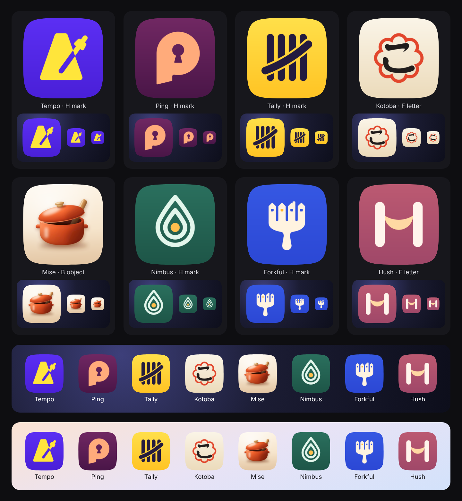

# Market benchmark — fixing the 3D monoculture against real App Store icons

The showcase (`showcase.md`) found the skill's weakest point. All eight of its icons followed one
formula: a centred, softly lit 3D object on a gradient tile, like one illustrator's portfolio. This
round tested the skill against **the real leading apps of eight categories**, to find out what
professional icons look like and to fix the bias.

## Method

- **Reference set:** the App Store icons of 4–5 leaders per category, 37 in all (music, messaging,
  food delivery, meditation, to-do, language learning, cooking, weather). They were used **only as
  neighbours for judging distance**: they stay out of this repository and no run copied them.
- **Briefs:** every brief uses a made-up app name (Tempo, Ping, Forkful, Hush, Tally, Kotoba, Mise,
  Nimbus). Each run had only the skill, the brief and the folder of real icons
  (`render.js --neighbours`).
- **Judging:** each icon was placed inside its category's real row at 60pt and 29pt, on dark and
  light wallpapers, and scored by eye.

## What the market looks like

- **Style.** About four in five leaders are **flat brand marks or letterforms** on a saturated or
  white tile. A few are short wordmarks; one is a character (Duolingo) and one a skeuomorphic object
  (Things 3). Rendered 3D objects are the exception.
- **Size.** Measured with `validate.py`'s own metric, the leaders' marks cover a **median 20 % of the
  tile** (middle half 15–30 %); only heavy discs (Spotify, Telegram) reach 45–55 %. The skill's old
  guidance of 28–45 % was calibrated for lit objects and made correct flat marks look undersized.
- **What the old rules got wrong.** They said "flat icons fail", broke ties toward "more volume",
  required material for every style, and listed a disc inside the tile, white tiles and wordmarks as
  anti-patterns. All four are common among the leaders.

## Three rounds of the style rule — and the bias each one revealed

| Round | Rule | Result | What it taught |
|---|---|---|---|
| 0 | tone table, ties go to "more volume" | 8 of 8 soft 3D objects (showcase briefs) | volume as the tie-breaker makes everything 3D |
| 1 | map the market; shortlist one graphic and one illustrative style; compare | 8 of 8 flat marks (6 market briefs + 2 controls) | the comparison was rigged: a graphic block-out is nearly finished, an illustrative block-out has had its light and material stripped |
| 2 | equal fidelity: each finalist gets a pass in its own idiom; 29pt is a pass/fail gate | 3 reruns: cooking → rendered pot, rain alerts → flat mark, music → rendered cassette | distance ranked above tone, so in a flat market every illustrative option "wins" (the cassette went against the brief's "rebellious, modern") |
| 3 (current) | two gates (29pt; differ from every leader on two of style family / hue / silhouette), then **tone decides** | — | the music run's own log shows its flat candidate passed both gates and won on tone; inferred from that log, not re-run |

Each wrong rule produced a monoculture *that looked like evidence*, and only the market comparison
showed it. The current rule names the decisive tone words in the concept note, so the choice can be
audited.

## Results

| Icon | Style | Concept | Verdict next to the real leaders |
|---|---|---|---|
| Tempo (music) | H mark | acid-yellow metronome on ultraviolet, its arm flung out through its own side | **8** — the only violet and yellow in the row; reads at 29pt; could pass as a real competitor. A metronome hints "tool" before the brand is known |
| Ping (messaging) | H mark | an apricot P that is also a speech bubble, with a keyhole for its counter, on plum | **8** — two meanings in one silhouette; the only warm, dark tile. Leans a little "security" |
| Tally (to-do) | H mark | an ink tally gate on yellow; the fifth stroke is the week counted | **7.5** — the only non-tick and the only yellow in its row; hatches at 20pt |
| Kotoba (Japanese) | F letter | a brushed こ inside a teacher's red hanamaru, on washi cream | **7.5** — the most culturally specific icon; non-readers see "a red flower ring" |
| Mise (cooking) | B object | tomato-enamel pot, lid propped on a wooden spoon, on linen | **7.5** — warm, premium, the only pale tile; shares Paprika's red family, the spoon vanishes at 29pt |
| Nimbus (rain alerts) | H mark | a raindrop drawn as radar contours closing on an amber "you" dot, on evergreen | **7.5** — the only green; refined. The drop is still RainViewer's sign |
| Forkful (food) | H mark | a cream fork whose tines are a row of terraced houses, on cobalt | **7** — the only blue tile and the only icon about the place; smaller than Grubhub's GH, faint paintbrush echo |
| Hush (meditation) | F letter | a cream H whose crossbar is a crescent moon slung like a hammock, on dusty rose | **6.5** — clean, but close to a plain H at small size; the moon reads as a smile |

Average 7.4, against 7.1 for the soft-3D showcase. The bigger change isn't the number: these sit in
their categories as peers of the market's icons instead of looking like illustrations. The strongest
two would pass as real competitors; the leaders still win on silhouette perfection and recognition,
which a brief cannot buy.

## Changes made to the skill

- `references/design-process.md` §2: map the market; one graphic plus one illustrative candidate;
  equal fidelity; two gates, then tone; finish follows the style.
- `references/styles.md`: new **H Brand Mark** and **I Character**; F widened to letterforms and
  wordmarks of up to five letters; anti-patterns corrected.
- `references/critique.md`: the finish is judged by the style's own standard, and the fixes no
  longer turn flat marks back into lit objects.
- `scripts/render.js --neighbours <folder>`: real icons as neighbours in `preview.png` and
  `compare.png`.
- `scripts/validate.py`: coverage reference calibrated to the leaders; flat colours and near-white
  tiles are no longer warnings.
- `assets/examples/tempo.svg`: the first graphic-family worked example; the other four are
  illustrative or luminous.

## Cost

~150–200 k tokens and 5–10 minutes per icon, including the two-candidate comparison. Eleven runs in
all: eight under the round-1 rule (six market briefs plus two controls) and three A/B reruns under
round 2, all three resumed after a usage-limit stop.
