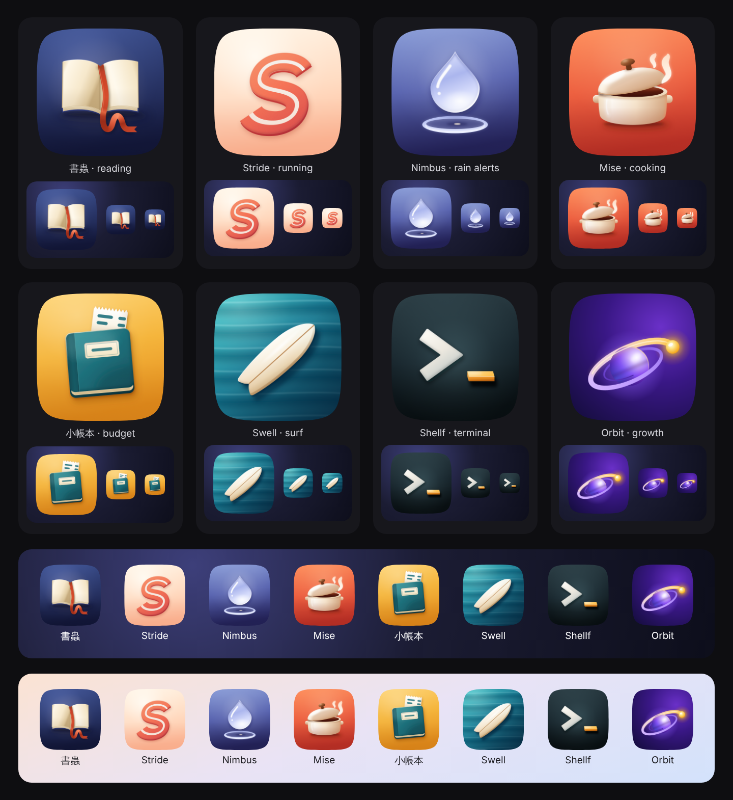

# Showcase — what the skill actually produces

Eight icons, each made by a fresh agent that only had this skill and a one-paragraph brief. Nothing
was retouched afterwards. The top four are from briefs the skill had never seen. The bottom four come
from the eval and field-test runs (小帳本 and Swell from iteration 2, Shellf from iteration 3, Orbit
from the field test, now live in that app).

| Icon | Brief | Concept | Verdict |
|---|---|---|---|
| 書蟲 | reading log, used in bed before sleep; quiet, literate, not old-fashioned | open book under a lamp on deep ink; the vermilion ribbon slips out and arches like an inchworm | **8/10** — calm and legible at every size; the inchworm twist shrinks to a red hook at 29pt |
| Mise | weeknight cooking PWA; warm, playful; no chef hats or cutlery | cream enamel pot, lid hopped up, steam escaping | **7.5** — warm, instant read; literal, the steam vanishes at 29pt |
| 小帳本 | budgeting page, brand teal + amber | teal cloth ledger with a receipt tucked in, on an amber tile | **7.5** — one of the strongest on a home screen; the notebook itself is fairly generic |
| Orbit | growth tracker (field test) | spiral orbit that widens and brightens; the gold body lights the planet | **7.5** — the most refined render and also the busiest; at 29pt still "planet with a ring" |
| Swell | surf forecast PWA, brand #0E7490 | fish surfboard from above on corduroy swell | **7** — clear subject; the board is flat-ish, the swell lines read a little like brushed metal |
| Shellf | dark web terminal, "hacker-ish but not cheesy" | `>_` with the cursor as an amber 3D shelf | **7** — instantly a terminal; ownership rests on the cursor alone |
| Nimbus | hyperlocal rain alerts; calm, precise; no sun-and-cloud | a glass raindrop hovering over a ripple ring, map-pin style | **6.5** — elegant, but collides with drink-water reminder apps; low contrast at the tip |
| Stride | first-half-marathon training, brand #FF6B4A | the S built from a running-track lane | **6** — clean and distinctive on a pale tile, but the track idea doesn't read: a generic S at 2.4:1 contrast |

## Where this leaves the skill

- **Clears the brief's bar:** every icon is app-specific, lit and material, reads at 29pt, and
  none is "a shape on a gradient". Six of eight are shippable with at most a small tweak.
- **Below top-tier hand-made icons:** surfaces are clean but thin on craft detail (texture, secondary
  light, edge wear), and a few concepts are literal.
- **Systematic bias:** all eight use the same formula — one centred, softly lit 3D object on a
  gradient tile. They look like one illustrator's set. Styles C–E (glass, paper, luminous) and bold
  flat graphics were never chosen, even where the tone allowed them. This is the next thing to fix:
  make the style choice argue against the default, not drift to it. → Done in
  [market-benchmark.md](market-benchmark.md): tested against real App Store leaders, three rounds of
  the style rule, and the bias each round revealed.
- **Cost:** 150–190 k tokens and 6–11 minutes per icon (block-out plus three material rounds).
